.. _openstack-weblate-guide:

==================================
Translating with OpenStack Weblate
==================================

OpenStack Weblate provides a web interface for translating OpenStack
projects. This guide describes how to sign in, select a translation,
translate a string, and check the saved translation.

The examples use Korean translations of the I18n Contributor Guide in the
``i18n`` project's ``doc`` component. Select your own project and language
when following the steps. The screenshots use the English interface of
Weblate 2026.10.1, with numbered red boxes indicating the relevant controls.

Signing in
----------

Use your OpenInfraID account to sign in to
`OpenStack Weblate <https://openstack.weblate.cloud/>`_. If you are already
signed in, you can proceed to selecting a project.

On the OpenInfraID sign-in page:

1. Enter your account email address in **Email Address**.
2. Click **>** to continue to the password screen.

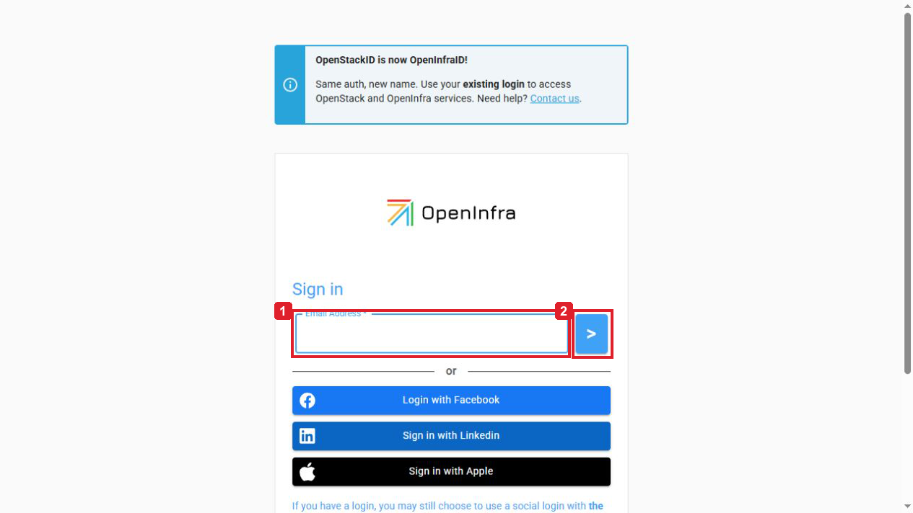

   **1.** Email address. **2.** Continue to the password screen.

Enter your password in **Enter Your Password** and click **Continue**.
After signing in, you return to the Weblate **Dashboard**.

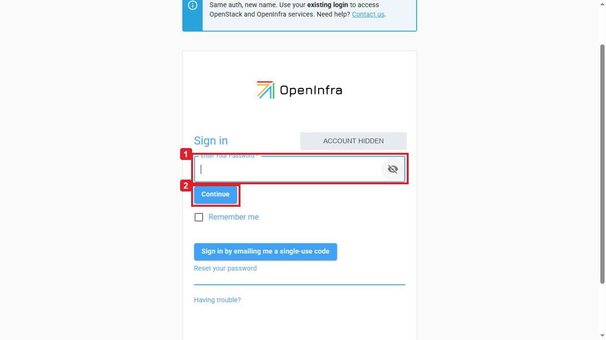

   **1.** Password field. **2.** Continue to Weblate.

Selecting a translation
-----------------------

Select a project
~~~~~~~~~~~~~~~~

Open **Projects** in the navigation bar and select **Browse all projects**.
If the project already appears in the Projects menu, you can select it
directly.

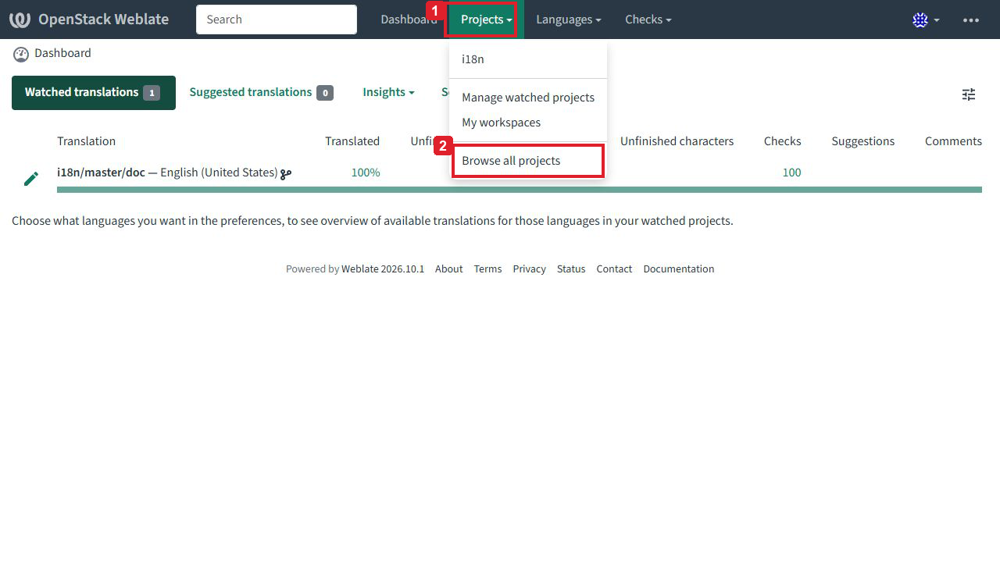

   **1.** Projects menu. **2.** Browse all projects.

Find the project you want to translate. In this example, select **i18n**.

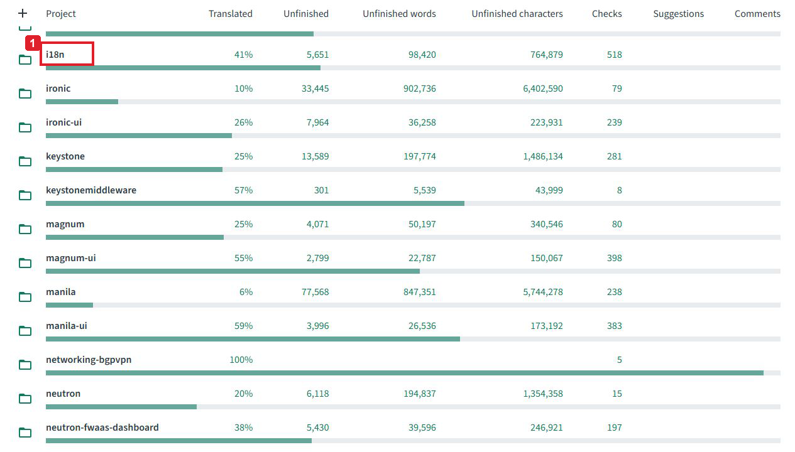

   Select the i18n project.

Select a language and component
~~~~~~~~~~~~~~~~~~~~~~~~~~~~~~~

On the project page, select your target language. This example uses
**Korean (South Korea) (ko_KR)**.

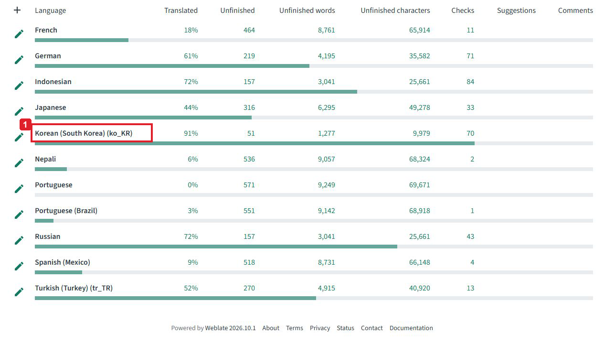

   Select the target language.

Open the **Components** tab and select the component to translate.
For the I18n Contributor Guide, select **doc** under **master**.
Other projects may have different component names.

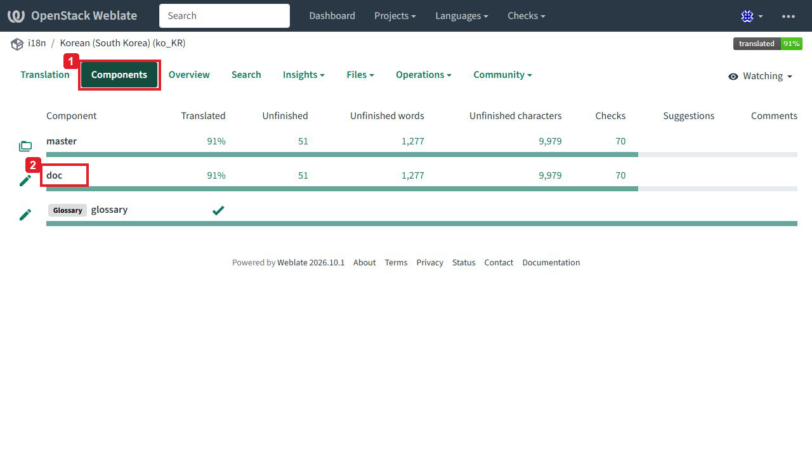

   **1.** Components tab. **2.** Documentation component.

Find untranslated strings
~~~~~~~~~~~~~~~~~~~~~~~~~

Check the project, component, and language in the breadcrumb at the top of
the page. On the **Translation** tab, click **Untranslated strings** in the
**Strings status** section to open a string with an empty translation.

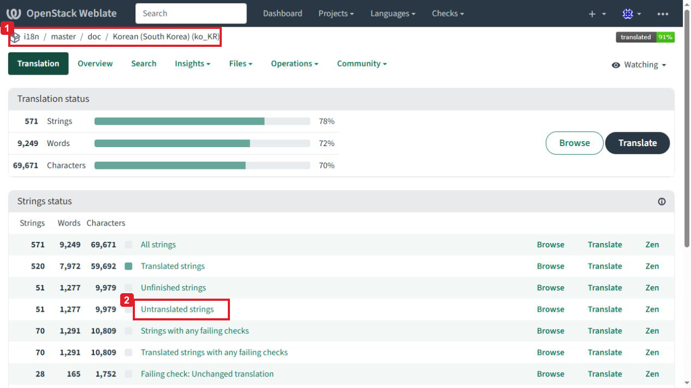

   **1.** Project, component, and language. **2.** Untranslated strings.

You can also use **Unfinished strings** to work on untranslated strings
and translations that need editing. Use **All strings** to review existing
translations, or **Strings with any failing checks** to inspect problems
reported by automatic checks.

Translating strings
-------------------

Read the source and context
~~~~~~~~~~~~~~~~~~~~~~~~~~~

Read the source text above the translation field. In this example, the
source language is **English (United States)** and the translation field
is labelled **Korean (South Korea) (ko_KR)**.

The **String information** panel shows the string's format and its
location in the source files. For documentation strings, this can help
you find the surrounding text in the original document.

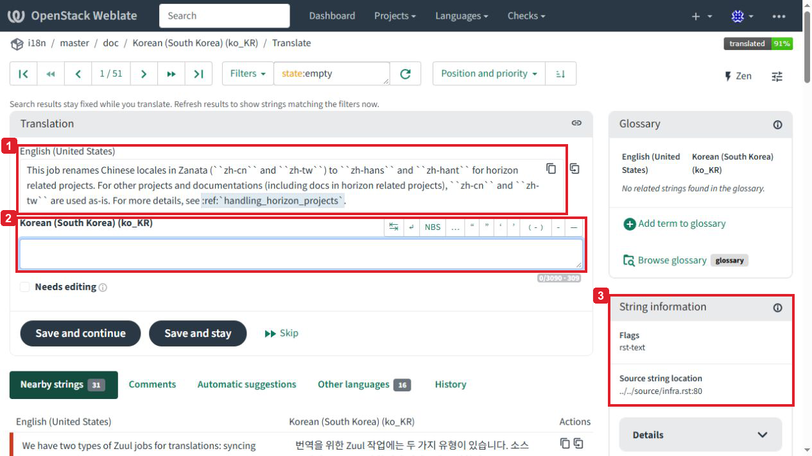

   **1.** Source text. **2.** Translation field. **3.** String information.

Use **Nearby strings** to read the surrounding strings and **Glossary**
to check terminology. Review any **Automatic suggestions** against the
source before using them in your translation.

Preserve formatting
~~~~~~~~~~~~~~~~~~~

Translate the text while preserving code, URLs, placeholders, and markup.
Documentation strings may contain reStructuredText (RST) formatting.
For example, the source string shown here contains inline code and a
Sphinx cross-reference:

.. code-block:: rst

   ``zh-cn``
   ``zh-tw``
   ``zh-hans``
   ``zh-hant``
   :ref:`handling_horizon_projects`

Keep the backticks, role name, and reference identifier intact. Preserve
the whitespace needed to separate inline markup from surrounding text.
Use the project's terminology and retain the meaning of any conditions,
exceptions, and negations in the source.

The Korean translation in this example reads as follows:

.. code-block:: rst

   이 작업은 horizon 관련 프로젝트에서 Zanata의 중국어 로케일(``zh-cn`` 및 ``zh-tw``)
   이름을 ``zh-hans`` 및 ``zh-hant`` 로 변경합니다. 다른 프로젝트와 문서(horizon 관련
   프로젝트의 문서 포함)에서는 ``zh-cn`` 및 ``zh-tw`` 를 그대로 사용합니다.
   자세한 내용은 :ref:`handling_horizon_projects` 를 참조하세요.

The translation is entered as one paragraph. The line breaks above are
for readability. Service names such as Zanata are part of this source
text and are preserved in the translation.

Save the translation
~~~~~~~~~~~~~~~~~~~~

Enter your translation and review it against the source. Select
**Needs editing** if it still requires further work.

While you are editing, **Unsaved changes!** appears below the translation
field. Click **Save and stay** to save the translation and remain on the
current string.

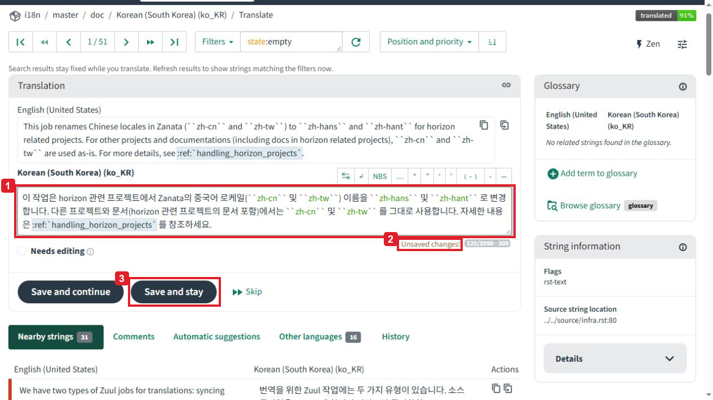

   **1.** Translation. **2.** Unsaved changes. **3.** Save and stay.

To save and move to the next string, use **Save and continue**.
Use **Skip** to move on without saving the current edit.

If a check reports a problem, compare the translation with the source
and correct it. For RST strings, check backticks, references, links,
and whitespace.

.. note::

   Available controls depend on the project and your permissions.
   If you can only submit suggestions, follow the project's instructions
   for having a suggestion reviewed.

Checking the saved translation
------------------------------

Open **History** below the editor to view changes to the string.
A newly added translation appears as **Translation added**. Check the
**Current translation** text and its state. A completed translation is
shown as **State: Translated**.

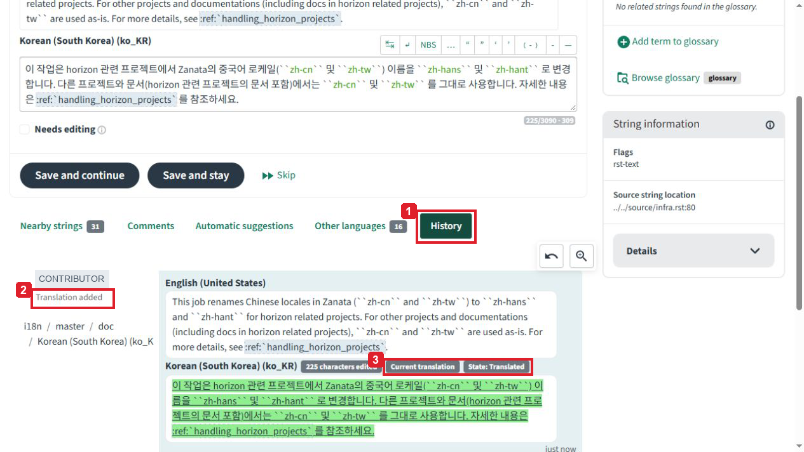

   **1.** History tab. **2.** Translation added. **3.** Current state.

Use **Copy permalink** to keep a link to a string for later review.

Continuing translation
----------------------

After using **Save and stay**, click **Next** in the top toolbar to open
the next string. When working through several strings, use
**Save and continue** to save each translation and move on.

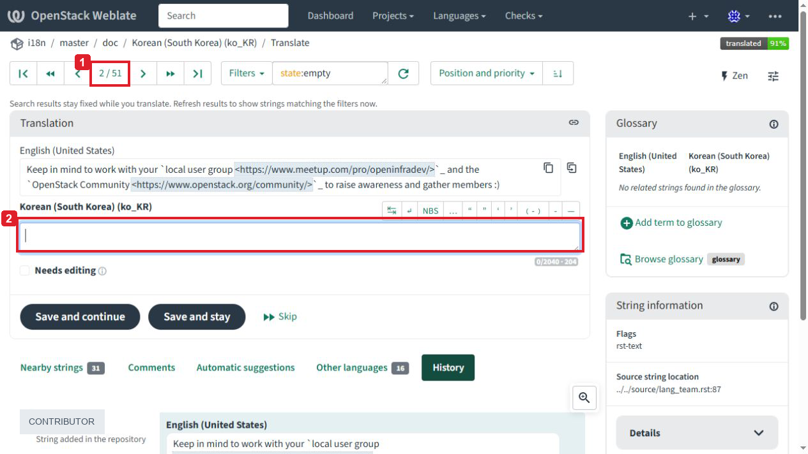

   **1.** Current position. **2.** Translation field for the next string.

Search results stay fixed while you translate. To update the list after
saving a translation, click **Refresh results**, the circular arrow to
the right of the query field. This updates the results to match the
current filter.

For more information about the editor and translation workflows, see the
`Weblate user documentation
<https://docs.weblate.org/en/weblate-2026.10.1/user/translating.html>`_.
